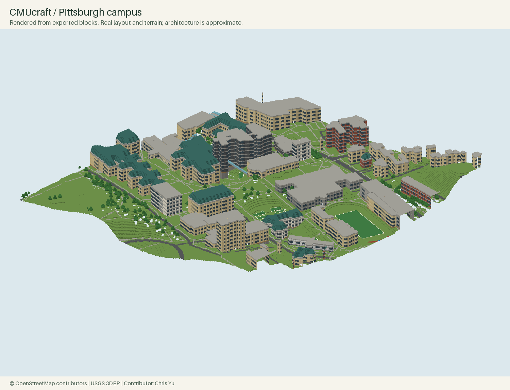

# CMUcraft

A Minecraft Java reconstruction of Carnegie Mellon University's Pittsburgh campus.

**Contributor: Chris Yu ([Schrodinger39](https://github.com/Schrodinger39)).**



## Current release: v0.2

A **1024 × 1024 metre Java 1.16.5 world**, generated from real OpenStreetMap footprints and paths, USGS elevation, and CMU's published building inventory. One horizontal block represents one projected metre. The scene includes surrounding neighborhood buildings; the count is not a count of CMU-owned buildings.

| Delivered | Count / status |
| --- | --- |
| Buildings and complexes | 342 |
| OSM road / path segments | 888 |
| Elevated bridge segments | 12 |
| Mapped trees | 337 |
| Generated chunks | 4,096 |
| Tests | 27 passed locally |
| Whole-world audit | All 4,096 chunk records decoded; palette indices and region allocation checked |

**This is a runnable architectural approximation, not a finished survey-grade replica.** Footprints and route geometry are real source data. Building heights derived from floors, facade rhythms, roof shapes, bridge elevations, and interiors are estimates. The 2022 CMU inventory is historical. A full realistic reconstruction still needs current exterior references, measured heights, detailed building parts, interior plans, and game walkthroughs.

## Open the world

Download **CMUcraft-Pittsburgh-v0.2.zip** from [Releases](https://github.com/Schrodinger39/CMUcraft/releases), then place its `CMUcraft-Pittsburgh-v0.2` folder in your Minecraft `saves` directory. This is a normal world save: **no WorldEdit or extra mod is required**.

For the delivery computer, a separate copy is installed under the existing Minecraft saves directory. In Minecraft Java 1.16.5, choose **Singleplayer → CMUcraft - Pittsburgh Campus**. Existing worlds are not modified.

- Creative mode, peaceful difficulty, fixed midday, no mob spawning.
- Spawn on The Cut at approximately `(475, 85, 589)`.
- `campus_artifacts/destinations.json` includes teleport commands for named buildings.
- Basic interiors have open floors, lights, and ladders. They are navigation placeholders, not real floor plans. Entrances may be inferred. Creative flight is available where grade changes or approximate bridges prevent a continuous walking route.
- A world border keeps exploration within the modeled square. Off-campus sites outside this square are not included.
- Java 1.16.5 data format is the target. Newer Java editions may upgrade a copied world; downgrade is not supported. Bedrock Edition is not supported.

Runtime loading in a Minecraft client is **not yet verified**. The installed Java launcher could be opened but its window could not be controlled by the available UI tool; file validation is not presented as an in-game test.

## Rebuild without a GUI

Python 3.10+:

```bash
python3 -m venv .venv
source .venv/bin/activate
python -m pip install -r requirements.txt
python -m pytest -q
python -m cmucraft.campus --output build/campus
```

The output directory must not contain an existing world; the generator refuses to overwrite one. The committed OSM/DEM sources allow offline builds after dependencies are installed. An approximately 200 MB voxel array is used for the current map; Python and rendering add overhead. This is designed for an 8 GB Mac, without a GIS GUI. Minecraft memory is separate.

Refresh the source data only when intentionally updating the snapshot:

```bash
cmucraft download --size 1024 --lon -79.9428 --lat 40.4433 --source data/raw/campus.osm
python scripts/download_terrain.py
```

Both source files have checksum/provenance sidecars. Network errors are reported; fabricated data is never substituted. The current full-world builder has a fixed documented campus extent; the underlying projection, footprint pipeline, region writer, and layer logic are reusable for larger tiled projects.

## Accuracy and source evidence

- **Layout:** original OSM source IDs, footprints, paths, tree locations, and named landmarks. Metric coordinates are EPSG:32617; X east, Z south. The earlier 256 m pipeline still runs with `cmucraft build` and its 55-pair distance validation remains available.
- **Terrain:** [USGS 3DEP](https://www.usgs.gov/the-national-map-data-delivery/gis-data-download), requested as a 4 m grid and bilinearly resampled to 1 m. This does not imply native 1 m elevation accuracy. Elevation range in this square is approximately 248–329 m; a constant offset maps it into Minecraft's vertical range. Building pads are flattened locally.
- **Architecture:** [CMU 2022 Institutional Master Plan, Appendix E](https://www.cmu.edu/cdfd/planning-and-design/master-plan/pdf/june-2022-cmu-imp-appendices.pdf), printed pages 158–163. Material families and raw level strings are captured in `data/reference/building_profiles.json`. Floor-to-floor height and roof geometry remain model assumptions, recorded per building.
- **Interiors:** procedural open floorplates, windows, lights, and ladders, not campus blueprints. No claim of room-level fidelity.
- **Bridges:** OSM horizontal alignments; estimated deck levels. Some OSM upper-level structures are represented as building footprints and need manual refinement.

The original 256 m view omitted most campus context. The new overview includes The Cut, The Mall, the stadium area, Forbes Avenue, the west-campus slope, and nearby residences. It remains a reconstruction with known approximations.

## Repository map

- `src/cmucraft/`: projection, OSM ingestion, 2D export, terrain/architecture generation, Anvil world writer.
- `data/raw/`: real OSM snapshots, USGS GeoTIFF, provenance and checksums.
- `data/reference/`: documented material and floor-count profiles.
- `campus_artifacts/world/`: ready-to-copy 1.16.5 world, including `level.dat` and four region files.
- `campus_artifacts/`: overview, isometric block render, building manifest, destinations, route descriptions, height and footprint arrays, whole-world audit.
- `artifacts/`: original 256 m survey outputs and schematic.
- `tests/`: geometry, distance, NBT packing, region layout, source and export tests.
- `docs/WEEK1.md`: original footprint pipeline documentation.
- `docs/ci/tests.yml`: inactive GitHub Actions template. The delivery credential lacks workflow permission; local tests ran successfully.

## License

Original code and documentation: MIT. OSM data and derived databases: ODbL 1.0, © OpenStreetMap contributors. USGS terrain is US government geospatial data. The code license does not relicense source datasets. See [DATA_LICENSE.md](DATA_LICENSE.md).
