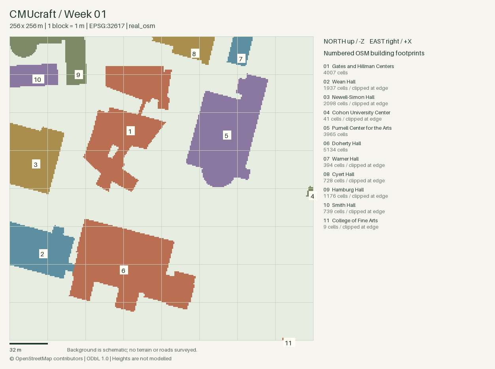

# CMUcraft

**A runnable, one-metre-per-block survey model of Carnegie Mellon University's Pittsburgh campus for Minecraft Java Edition.**

Week 1 delivers real OpenStreetMap building footprints, a 256 × 256 m raster, inspectable data exports, distance checks, and a Sponge `.schem` prototype. It does **not** yet recreate building facades, interior spaces, roads, or campus terrain.



## Delivered results

- Real OSM API response, preserved with its download URL, UTC timestamp, and SHA-256 checksum.
- 11 building or building-complex footprints intersect the selected region. Eight are clipped at the boundary; nothing is resized to fit.
- 20,228 occupied one-square-metre cells. Courtyards and disconnected components are retained.
- WGS84 → UTM zone 17N (`EPSG:32617`) → Minecraft X/Z.
- 55 pairwise building-centroid distance checks. Maximum projection difference from WGS84 geodesic distance: **0.112 m**, approximately **0.0302%** at most. Maximum additional centroid cell quantization difference: **0.846 m**.
- 16 automated tests, including real-data integration and schematic decoding.
- A flat, two-layer schematic: generic grass platform plus one-block-high stone-brick footprints. **That height is a placeholder, not an estimate of real building height.**

This is an independent student project, not an official CMU map. The current data snapshot was retrieved November 5, 2026, US Eastern time (November 6 UTC).

## Run locally

Python 3.10 or later. No GUI, Java, Minecraft installation, or GIS desktop application is needed to generate the outputs. Minecraft and WorldEdit are needed only to view the schematic in-game.

```bash
python3 -m venv .venv
source .venv/bin/activate
python -m pip install -r requirements.txt
cmucraft build
python -m pytest -q
```

Run these commands from the repository root. `build` uses the committed real OSM snapshot and needs no network connection after dependencies are installed. The generated deliverables are already included in `artifacts/`.

Dependencies are Shapely, pyproj, NumPy, Pillow, nbtlib, and certifi (HTTPS certificate verification); pytest is used for tests. There is no GeoPandas, OSMnx, rasterio, server, or heavy GUI requirement. `requirements-lock.txt` records exact package versions from the verified Apple Silicon environment; the version ranges in `pyproject.toml` allow compatible wheels on other Python/macOS versions.

To refresh real data, explicitly run:

```bash
cmucraft download
cmucraft build
```

Or use `python scripts/download_osm.py`. Refreshing changes the snapshot and its provenance. The downloader uses the official OSM small-area map API. An initial Overpass endpoint returned HTTP 406, so the delivered snapshot was obtained from OSM directly. A network failure produces an error; **no synthetic campus data is substituted**. The synthetic rectangles in tests are explicitly test fixtures, never campus data.

## Files

| File | Purpose |
| --- | --- |
| `data/raw/cmu.osm` | Unmodified real OSM XML response, including source object IDs and versions |
| `data/raw/cmu.source.json` | URL, source extent, retrieval time, checksum, and license |
| `artifacts/campus.png` | Numbered footprint preview, north arrow label, 32 m scale, clipped-building labels |
| `artifacts/buildings.geojson` | Clipped polygons in longitude/latitude, valid RFC 7946 coordinate convention |
| `artifacts/local_geometry.json` | Clipped geometry in Minecraft X/Z metres; intentionally not geographic GeoJSON |
| `artifacts/buildings.json` | OSM IDs, names, full/visible areas, centroids, tags, overlap and clipping information |
| `artifacts/grid.npy` | `uint16` grid indexed `[z, x]`; 0 means unoccupied, positive IDs match the building table |
| `artifacts/cells.csv` | Occupied cells only: `x,z,building_index`; omitted cells are unoccupied |
| `artifacts/distances.csv` | All full-footprint centroid pair distances and error components |
| `artifacts/report.json` | Provenance, coordinate origin, validation summary, parsing warnings and limitations |
| `artifacts/cmu_core.schem` | Minecraft Java / WorldEdit footprint prototype |
| `docs/VALIDATION.md` | What was actually tested and what remains unverified |

## Coordinates and accuracy

The selected square is centred at longitude **−79.9442**, latitude **40.4431**, near the Gates / Doherty / Purnell core. The square is aligned to the UTM grid, not rotated to campus buildings.

With `(E, N)` in UTM metres and the square's northwest corner `(E_west, N_north)`:

```text
X = E - E_west       east is +X
Z = N_north - N      south is +Z
```

The default origin is `(589410.360558431, 4477602.057049852)` in EPSG:32617. Floating coordinates range from 0 to 256; block indices range from 0 to 255. Block `(x,z)` represents the metre square `[x,x+1] × [z,z+1]`, sampled at `(x+0.5,z+0.5)`. A cell is occupied only when its centre is strictly inside a building polygon; a centre exactly on the boundary is excluded. Thin details can disappear. There is no scaling to fit the image or schematic.

The projection's approximately 0.03% local scale difference is small compared with one block, but it is disclosed rather than described as survey-grade exactness. Grid north also differs slightly from true north. Tests compare projected distances with independent ellipsoidal distances calculated by `pyproj.Geod`, as well as known-size synthetic shapes. **This validates conversion and proportion, not the accuracy of OSM's source measurements.** No independent field survey has been performed.

Distance checks use the centroids of complete source footprints, even when a building is clipped in the tile. Such centroids may be outside the tile, and a nonconvex building's centroid need not fall inside the building. The cell-distance column measures the cells containing those mathematical centroids, not occupied-grid centroids or entrance-to-entrance walking distances.

## Geometry handling

Closed ways, split rings, inner holes, multipolygons, and nested multipolygon relations are supported. Complete parent building complexes replace their consumed child features to avoid duplicate footprints. In particular, Gates and Hillman are represented by their combined parent complex in this snapshot. Upper-level bridge footprints included in OSM complexes remain part of the 2D projection; ground clearance is not modeled.

Malformed, missing, cyclic, or unsupported relation members are reported in `report.json`; invalid geometry is never silently repaired. The committed snapshot has zero parsing warnings. For unrelated overlapping features, the first feature in stable OSM-ID string order owns each raster cell; the original vectors, raw masks' cell counts, and overlap counts remain available for inspection. This snapshot has no such overlaps.

Changing the extent beyond the saved source bounding box fails rather than silently generating a partially downloaded campus. Download new data first.

## Import the prototype into Minecraft Java

The file follows [Sponge schematic version 2](https://github.com/SpongePowered/Schematic-Specification/blob/master/versions/schematic-2.md), with Java 1.20.1 data version 3465 and basic vanilla block states. A compatible WorldEdit installation is required. File structure and block ordering have been tested; **Minecraft/WorldEdit runtime loading has not been tested in this delivery**.

1. Put `artifacts/cmu_core.schem` in your WorldEdit schematic directory (`config/worldedit/schematics` for a typical mod installation, or `plugins/WorldEdit/schematics` on a plugin server).
2. In an empty creative test world, load it:

   ```text
   //schem load cmu_core
   ```

3. Stand at the intended northwest ground origin and run `//paste`. The clipboard offset is zero. It extends 256 blocks east (+X), 256 blocks south (+Z), and 2 blocks upward. For example, pasting at block `(0,64,0)` places ground at Y=64 and footprints at Y=65.
4. Use `//undo` if needed. Normal paste includes air in unoccupied upper-layer cells; use a clear area.

See the [official WorldEdit clipboard documentation](https://worldedit.enginehub.org/en/latest/usage/clipboard/) for installation-specific paths and command behavior. This is a survey slab you can walk around, not a finished campus world, `.mcworld`, or vanilla save folder.

## Expand the project

```bash
cmucraft download --size 512 --source data/raw/core512.osm
cmucraft build --size 512 --source data/raw/core512.osm --output artifacts512
```

Both commands accept `--lon`, `--lat`, and `--size`. The implementation validates UTM zone 17N and caps a single tile at 2048 m. The OSM map API has area/request limits: tile large regions and cache source data instead of repeatedly requesting a huge bounding box. Generated grids and schematics allocate memory proportional to tile area. A future multi-tile exporter should use a single shared UTM origin, with integer metre tile offsets, to avoid seams.

Next phases: independently verify landmark dimensions; acquire a DEM for elevation; add paths and roads; distinguish bridges and building levels; add evidence-based heights; then model facades, roofs, entrances and interiors. None of those are implied by this week's footprint prototype.

## Continuous integration template

`docs/ci/tests.yml` is a GitHub Actions template for Python 3.10 and 3.13. It is **not active**: the GitHub OAuth credential used for this delivery has repository access but lacks the `workflow` scope. GitHub rejected the initial push containing an active workflow. The template is preserved outside `.github/workflows/` so the complete project can be uploaded without changing account permissions. Local tests have passed. To enable CI later with suitable authorization, move it to `.github/workflows/tests.yml`.

## License and attribution

Code is MIT-licensed. **OSM source data and derived database outputs are not relicensed as MIT.** They are provided under ODbL 1.0; images and the schematic retain OSM attribution. See [DATA_LICENSE.md](DATA_LICENSE.md) and [OpenStreetMap copyright](https://www.openstreetmap.org/copyright). The upstream map response contains public OSM contributor metadata and is preserved unchanged for provenance.
