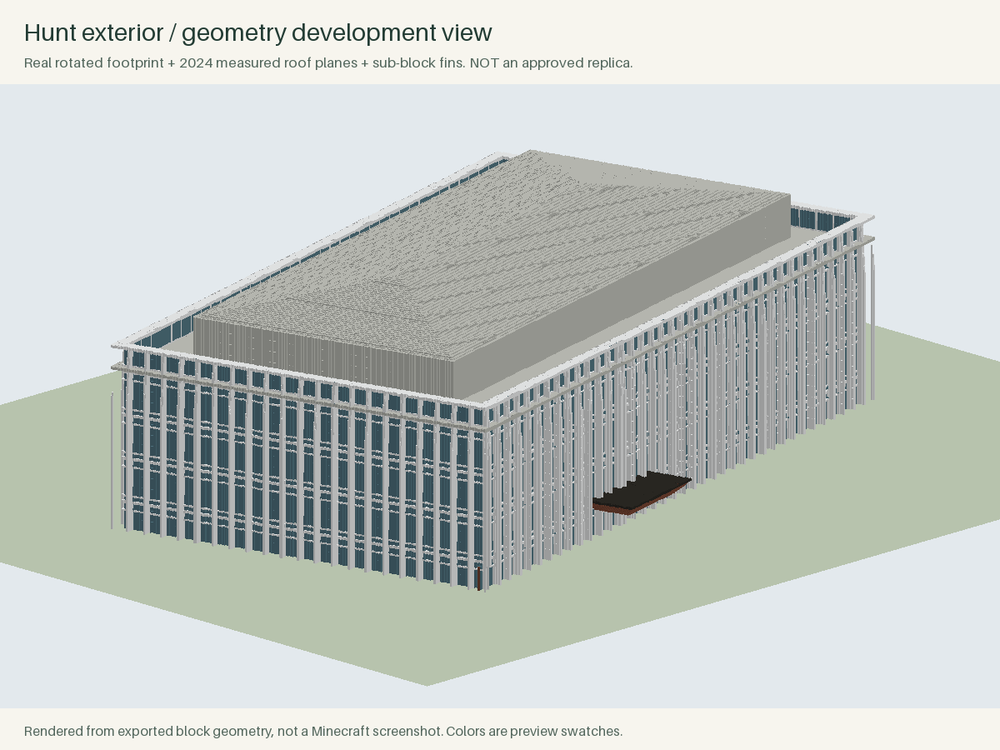

# CMUcraft

**Rebuilding CMU in Minecraft, just for fun.**

CMUcraft is a project to recreate Carnegie Mellon's Pittsburgh campus in Minecraft. The idea is simple: build a place we know, explore it with friends, and make something fun together.

Hopefully, it can also become a cool way for people who are new to CMU to explore campus and get a feel for where things are before arriving. That is a goal, not a promise that the current map is accurate enough for navigation.

It's still a work in progress. If you know campus, enjoy building in Minecraft, or just want to help, contributions are welcome.

This is an independent student project, not an official CMU map. The full-campus preview is still rough, and Hunt Library is the first detailed specimen. You can start by looking at the images below; Minecraft, Python and a different launcher are not prerequisites for giving feedback.

[Try the preview](https://github.com/Schrodinger39/CMUcraft/releases/tag/v0.3.0-preview) · [How to contribute](CONTRIBUTING.md) · [Future plans](ROADMAP.md) · [Report a problem](https://github.com/Schrodinger39/CMUcraft/issues/new/choose) · [Development journal](DEVLOG.md)

## Start with Hunt or CUC

Our first contributor round focuses on **Hunt Library** and **Cohon University Center**.
Help make them recognizable: try one exterior detail, share a reference, or tell us
what the rough model misses. No Python, Git, or whole-building commitment required.

| Pick a first contribution | What to share | Join here |
| --- | --- | --- |
| Hunt window-and-fin section | A small private build or annotated reference, plus a sentence about your design | [Hunt task #3](https://github.com/Schrodinger39/CMUcraft/issues/3) |
| CUC entrance or facade | A photo/link identifying the side and two or three observations; no Minecraft needed | [CUC task #4](https://github.com/Schrodinger39/CMUcraft/issues/4) |
| Show the real game | A game-only screenshot with its location and world name | [Screenshot task #5](https://github.com/Schrodinger39/CMUcraft/issues/5) |

**[Download First Builds — Hunt + CUC](https://github.com/Schrodinger39/CMUcraft/releases/tag/builders-round1)**
· **[Short Builder guide](docs/BUILDERS.md)**

Import the combined `.mrpack` as a new instance to get the pinned mod download list
and both trial worlds. You can download, try and post a proposal without waiting for
a claim. Each building has one main-save coordinator once someone volunteers;
whole-building integration still needs an agreed scope. There is no shared server.

A local three-block C&B sample passed save/re-entry and transfer into a second campus
copy with another re-entry. This newly packaged download has not had a fresh launcher
import test; CUC's new trial world and full-building collisions remain unverified.
See [what was actually tested](docs/BUILDER-VALIDATION.md). Reference tasks need no installation.

Hunt design reference — external render, not a game screenshot

This separate prototype is a design reference, not the rough building included in
the trial worlds. Facades and in-game behavior are not fully accepted. We are
collecting game-only views in [task #5](https://github.com/Schrodinger39/CMUcraft/issues/5).

## What is here today?

| Part | Current state |
| --- | --- |
| Full-campus context | A 1024 × 1024 m legacy approximation with buildings, paths and terrain. Useful for comparison; architecture needs revision. |
| Hunt Library | Separate detailed specimen with silver fins, recessed glazing, window frames, an entrance canopy and a measured roof model. Not yet accepted as a finished replica. |
| Geographic pipeline | Real OSM footprints → metric coordinates → 1 m cells → inspectable exports and Java world files. |
| Survey evidence | Reproducible 2024 point-cloud processing and 41 building reference packets. Reference packets are not completed models. |
| Modpack | Pinned Forge build with Chisels & Bits, WorldEdit, FerriteCore and Xaero maps. |
| Validation | Automated geometry, units, storage and repair tests. A local C&B small-sample save/integration/re-entry test passed; complete-building and multiplayer checks remain open. |

The earlier v0.2 world was not recognizable enough during a campus walkthrough. It remains available as a legacy reference, not as the target quality. Better screenshots alone will not solve that: the project needs building-by-building checks.

## Try the current preview

**You do not need HMCL.** The world uses Minecraft Java 1.16.5 + Forge 36.2.42; the launcher is a way to set up that environment, not part of the campus itself. You need your own access to Minecraft Java to play. You do not need Python or Git to try the downloaded worlds.

1. Download **CMUcraft-Preview.mrpack** from [v0.3.0-preview](https://github.com/Schrodinger39/CMUcraft/releases/tag/v0.3.0-preview).
2. Import it as a separate instance in a launcher that supports `.mrpack`. HMCL is the existing local setup; [Prism Launcher documents importing this format](https://prismlauncher.org/wiki/help-pages/Zip-import/). **Prism's format support is not a completed test of this particular pack.**
3. Choose **Hunt Detail Preview** for the detailed building, or **Campus Preview (Legacy Geometry)** for the rough campus overview. They are separate worlds, not two parts of one finished map.

If your launcher cannot import `.mrpack`, see [launcher options and the manual route](docs/LAUNCHERS.md). There is also a worlds-only ZIP, but it does not install the required mods. You do not have to switch launchers just to report a building mismatch or contribute photos.

Xaero's World Map uses **M** by default and fills as you explore. Hunt requires Chisels & Bits; opening it without the mod can lose its details. Keep copies of saves before changing versions. Bedrock is not supported.

The known experimental-world-settings defect has been corrected and checked with Minecraft 1.16.5's own parser. **That check does not establish Forge client compatibility.** The legacy kit small-sample save/integration test passed on the existing local setup. Detailed Hunt-specimen rendering, collisions and multiplayer still need direct testing. There is no hosted multiplayer server.

See the [modpack guide](modpack/README.md) for versions, credits and verification limits. The separate worlds ZIP is for people who already have the matching environment.

## How is the campus built?

### The simple version

Imagine tracing each building on a map, putting that drawing on squared paper, and using a program to place Minecraft blocks on the squares. Height measurements help decide how tall the buildings should be. Photos help work out what the windows, walls and entrances should look like.

That is roughly how CMUcraft works. The buildings were generated by Python programs rather than placed brick by brick in Minecraft. The program can place lots of blocks quickly, but it does not automatically know what makes a building look right. The first campus model used too many generic building patterns. Hunt is now being worked on separately, with more specific geometry and references.

### The technical version

| Step | Tools and approach | What this establishes |
| --- | --- | --- |
| Collect geometry | OpenStreetMap XML, independent county footprints, source hashes | Traceable building outlines and geographic context |
| Convert coordinates | Python, pyproj, UTM zone 17N (`EPSG:32617`) | Metre-based coordinates mapped to Minecraft X east / Z south |
| Make the grid | Shapely and NumPy | Polygon clipping, courtyards and 1 m footprint cells |
| Measure surfaces | USGS/PASDA 2024 lidar, laspy and Laszip | Observed ground/roof candidates with explicit unit conversion; vegetation still needs filtering |
| Model architecture | Building-specific Python rules, photographs and measured roof fitting | Geometry for features such as Hunt's fins, glazing and roof; some dimensions remain estimates |
| Add finer detail | Chisels & Bits, with 16 samples per block edge | Sub-block geometry for details that would be too coarse at one full block |
| Export and inspect | nbtlib, Java Anvil/NBT files, Pillow renders, pytest | Reproducible saves, geometry previews and automated checks |

WorldEdit is included as an editing tool. FerriteCore helps with memory use, and Xaero's maps help navigation. These mods do not automatically reconstruct architecture. No AI-generated image is used as proof that the exported world looks correct.

The underlying rule is one block per metre with a consistent campus origin. Source data, measured evidence and modeling guesses must remain distinguishable. Tests check specific properties such as coordinates and file storage; they cannot replace checking the actual buildings in-game.

For code, installation and reproduction commands, read [Developer setup](docs/DEVELOPMENT.md). For the detailed explanation of modules, arrays and save formats, read the [Code and file guide](docs/CODE_GUIDE.md).

## Contributing

**Minecraft Builders: [build one building without Python or Git](docs/BUILDERS.md).** Start in the Hunt or CUC task above. Fixed trial downloads are ready; a screenshot is enough for a first proposal. Full-save delivery is only needed when offering a build for integration.

Contributions to campus models, geographic data, generation tools and testing are welcome. See [CONTRIBUTING.md](CONTRIBUTING.md) for the development and review workflow, and [Future Plans](ROADMAP.md) for the project's direction.

Use issues to coordinate buildings and submit saves; use pull requests for code and documentation. There is no shared build server yet; models are developed in separate saves before integration.

## Where to read more

Each document has a specific job:

| Document | Use it when you want to… |
| --- | --- |
| [Builder guide](docs/BUILDERS.md) | Claim a building, open a kit and submit a save without coding |
| [Kit maintenance](docs/BUILDER-MAINTENANCE.md) | Generate kits, review changes and stage imports safely |
| [Builder compatibility](docs/BUILDER-COMPATIBILITY.md) | See evidence and unverified client tests |
| [Contribution guide](CONTRIBUTING.md) | Choose how to help, coordinate work and submit a contribution |
| [Future plans](ROADMAP.md) | Read the broader development priorities |
| [Launcher guide](docs/LAUNCHERS.md) | Install the preview using your launcher or troubleshoot setup |
| [Modpack reference](modpack/README.md) | Check exact mod versions, credits and verification limits |
| [Developer setup](docs/DEVELOPMENT.md) | Install Python dependencies and reproduce builds |
| [Code and file guide](docs/CODE_GUIDE.md) | Understand implementation details and data formats |
| [Survey guide](docs/SURVEY.md) | Download/process lidar and reproduce the roof evidence |
| [Reconstruction requirements](docs/RECONSTRUCTION.md) | Understand what must be checked before a building is accepted |
| [Development journal](DEVLOG.md) | Read the history of setbacks and decisions |

## Credits and licensing

Contributor: **[Chris Yu / Schrodinger39](https://github.com/Schrodinger39)**. New contributors can add their chosen name and contribution to [CONTRIBUTORS.md](CONTRIBUTORS.md) with their PR.

Original code and documentation use the [MIT license](LICENSE). OSM source data and derived databases have separate ODbL obligations, © OpenStreetMap contributors. Government survey data and third-party reference material retain their own provenance; the code license does not relicense them. Read [DATA_LICENSE.md](DATA_LICENSE.md). Third-party mods retain their authorship and licenses; the pack references upstream downloads and does not bundle Minecraft binaries.
