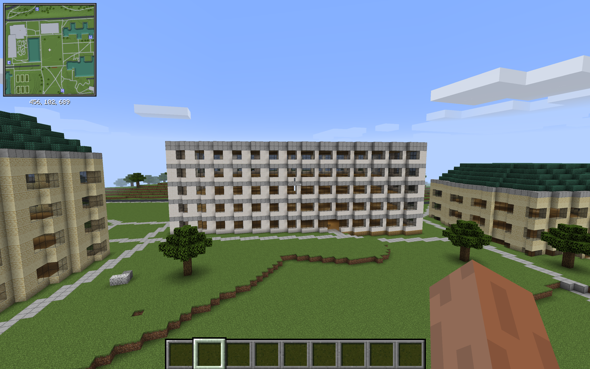
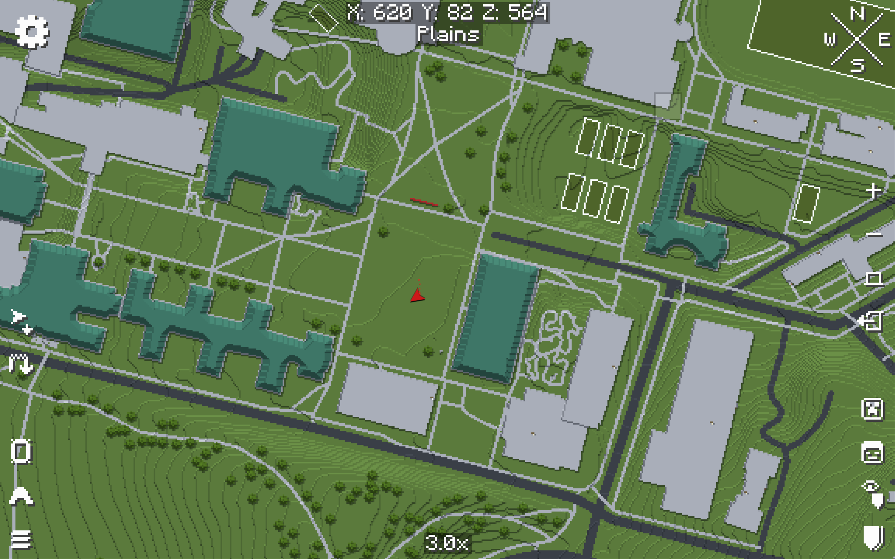
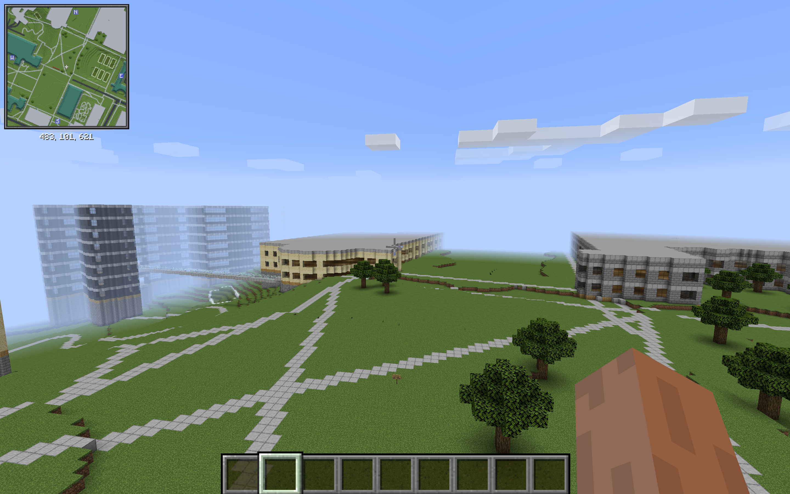

# Current game views

Screenshots supplied by Chris Yu on November 5, 2026 (America/New_York).
These are unedited game captures of the rough legacy campus, not external renders
or finished reconstructions. HUD/map overlays are retained as captured.
They do not establish architectural accuracy, C&B persistence or client validation
of the separate CUC trial download.

## Hunt area — rough, in-game

The current blockout is a starting point, not the separate detailed Hunt specimen.
[Help with Hunt](https://github.com/Schrodinger39/CMUcraft/issues/3).

## Campus map — in-game

An in-game view of the rough campus; not a surveyed or navigation-certified map.

## Campus context — rough, in-game

A wider campus view, not a dedicated CUC building portrait.
[Help with CUC references](https://github.com/Schrodinger39/CMUcraft/issues/4).

## Original-file record

Copied byte-for-byte from the screenshots provided for the project.
No cropping, generated replacement geometry or color edits were applied.

- `hunt-area-rough-in-game.png`: original capture at 11:13:11 PM; SHA-256 `bc8164b652249649e0c8d4f478b37f5fa1458000851be8d36ac1389ca2f4438e`.
- `campus-map-in-game.png`: original capture at 11:13:22 PM; SHA-256 `090cca30ba002a474cc06011f3c5f4f9260d7d1c55f2c787ab0886732c986d02`.
- `campus-context-rough-in-game.png`: original capture at 11:13:36 PM; SHA-256 `844ac33189a5f38d5c567bda815f2e1b20aa95b557213b084a1c08d5030aa12a`.
